# DevLens AI

> **Understand Skills. Compare Evidence. Find the Right Match.**

DevLens AI is a professional, AI-powered Developer Profile Analyzer, Technical Skills Assessment, Developer Comparison, and Job Matching Platform. Built as a unified full-stack modular monolith using **Next.js 15 (App Router)**, **TypeScript**, **Tailwind CSS**, and **Prisma ORM**.

---

## 📸 Visual Showcase & Platform Panels

### 1. Interactive Landing Page Hero (Hexagonal Vault)
Features the ReactBits Pro **Hexagonal Vault** canvas with **60 FPS** hardware acceleration, instant cursor trailing, and dual-mode palette adaptation:

| Dark Mode ("Mono" Palette: `#8A8A99` / `#FFFFFF` with Glowing Cores) | Light Mode ("Graphite" Palette: `#64748B` / `#0F172A`) |
| :---: | :---: |
| 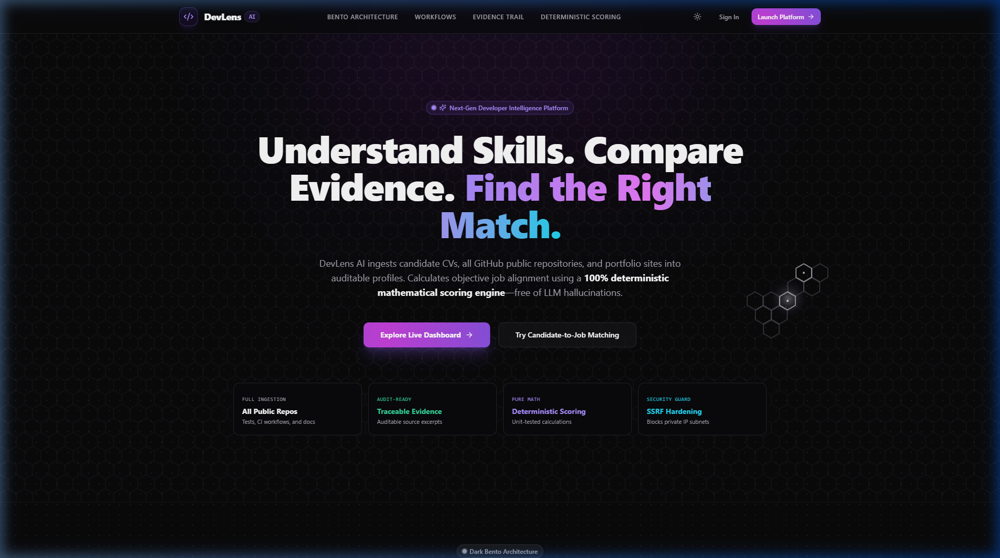 | 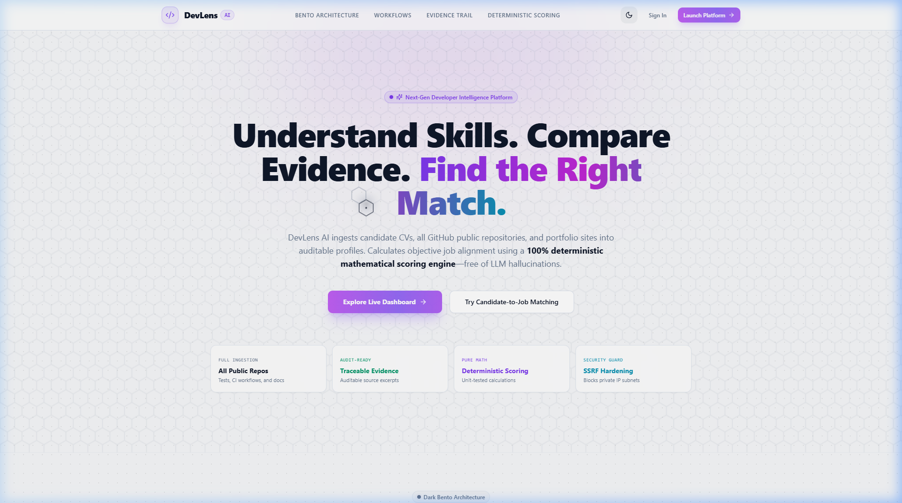 |

*Cursor Trail & Shimmer Illumination:*
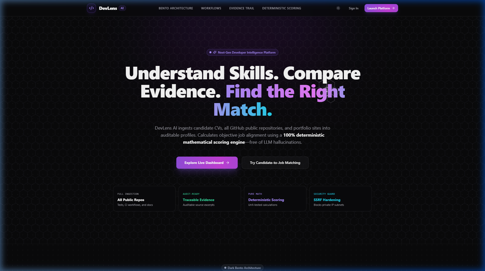

---

### 2. Executive Dashboard & Technical Evidence Hub
Bento grid overview displaying ingestion metrics, verified skills, and candidates:

| Dark Mode Dashboard | Light Mode Dashboard |
| :---: | :---: |
| 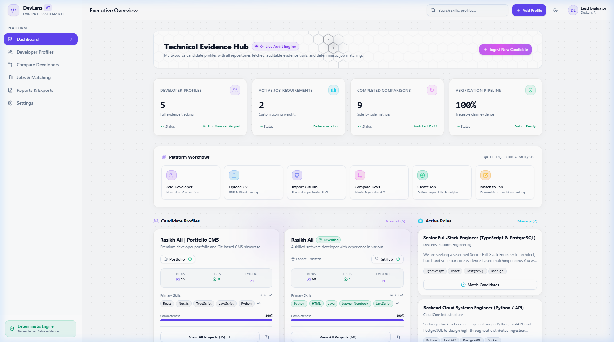 | 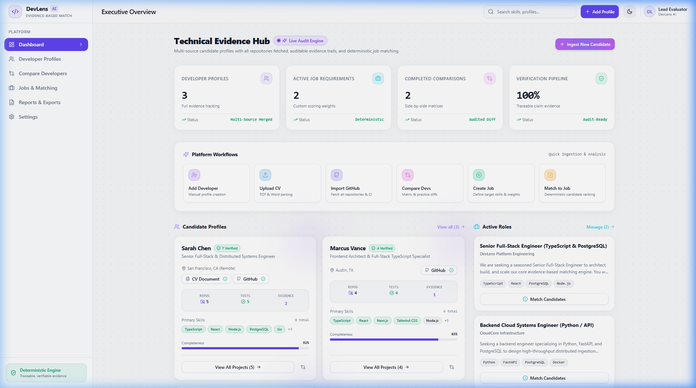 |

---

### 3. Candidate Dossier & Ingested Repositories Bento
Comprehensive developer profile with all public repositories ingested, automated test suite indicators, CI/CD status, and architectural complexity scores:

| Developer Overview & All Repositories | Work History & Traceable Evidence Trail |
| :---: | :---: |
| 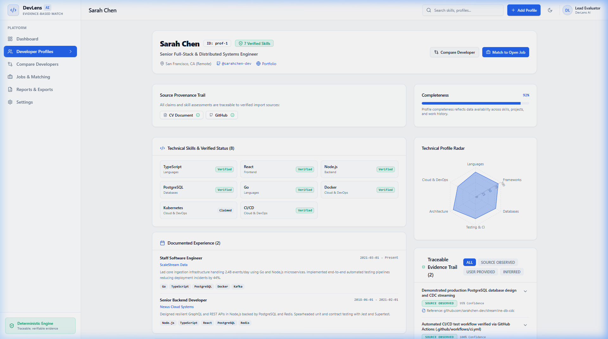 | 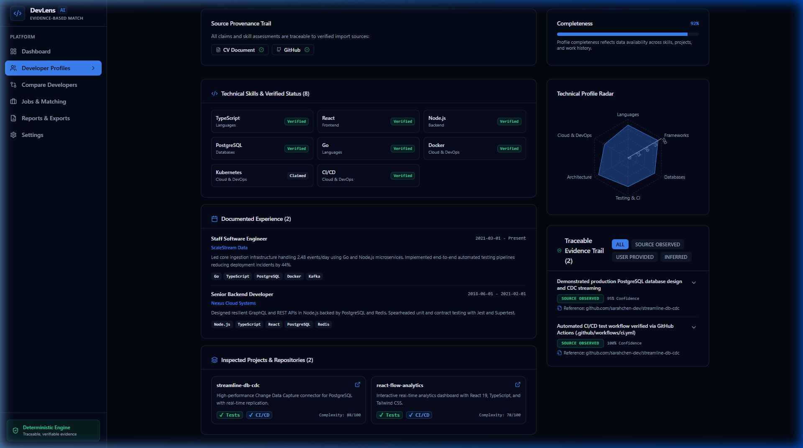 |

---

### 4. Developer vs. Developer Comparison Matrix
Side-by-side comparison across technical skills, repository depth, test suite presence, and CI/CD pipelines:

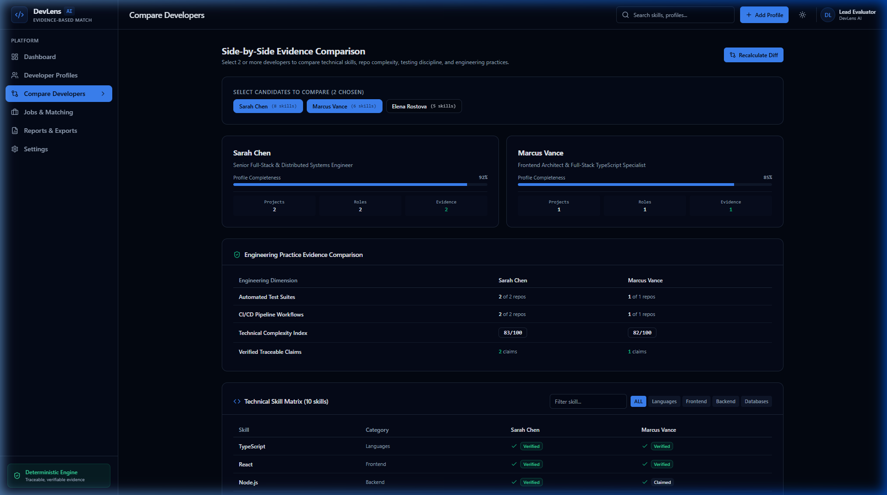

---

### 5. Deterministic Candidate-to-Job Matching
100% mathematical scoring with real-time dynamic weight sliders and downloadable CSV audit reports:

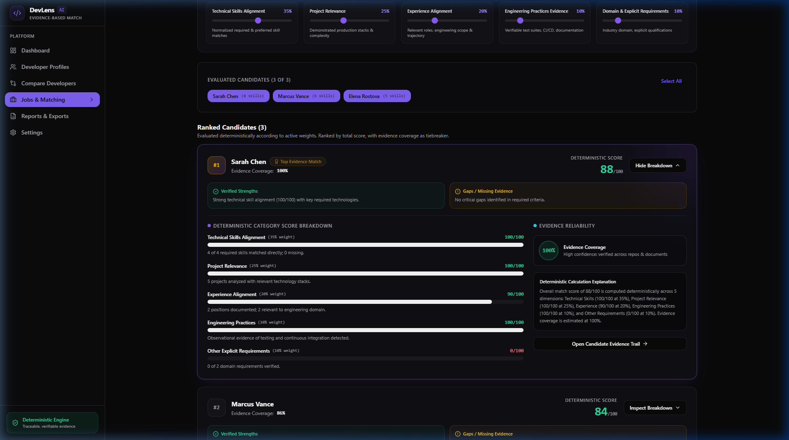

---

## 🏛️ System Architecture

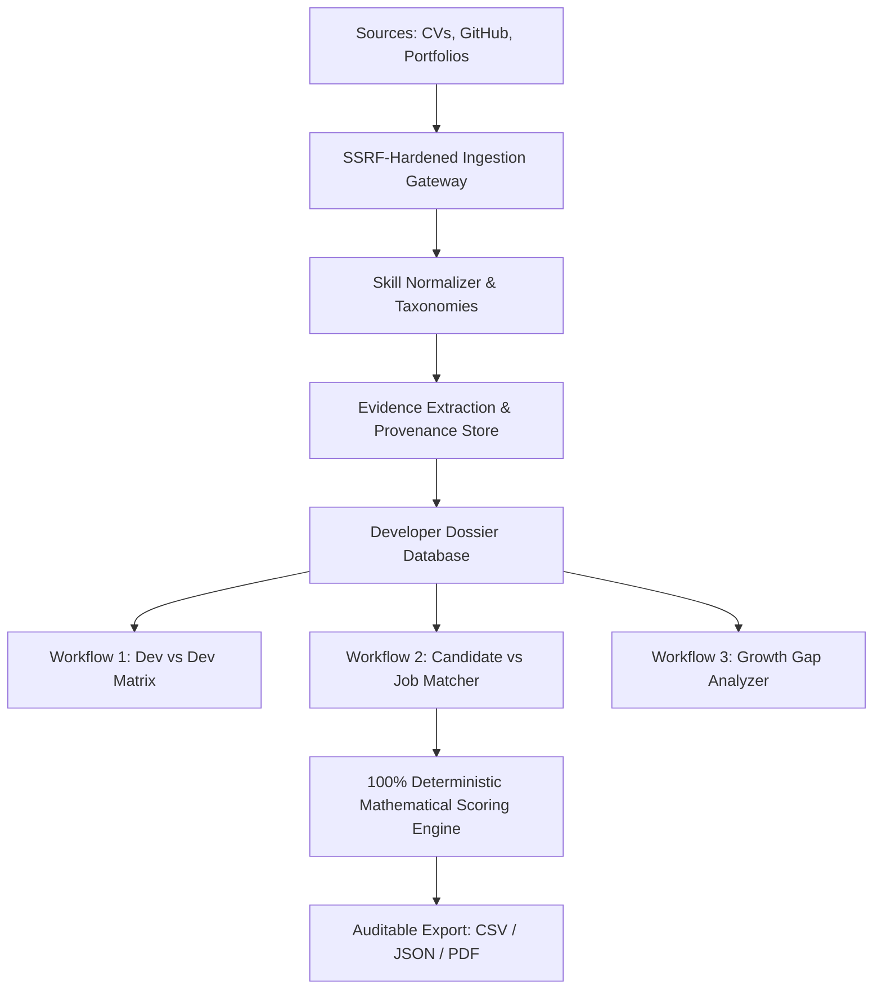

### Ingestion & Evidence Trail Pipeline

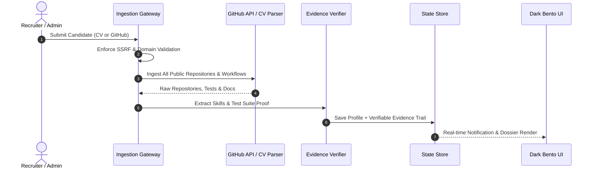

---

## 🛡️ Role-Based Access Control (RBAC) & System Credentials

DevLens AI enforces strict role-based access control. All dashboard routes require explicit authentication via the sign-in portal (`/sign-in`); unauthenticated attempts to access `/dashboard` or candidate dossiers automatically redirect to the login screen.

### Pre-Configured System Credentials

| Role | Email | Password | Privileges & Administrative Authority |
|---|---|---|---|
| **Administrator** | `admin@devlens.ai` | `Admin@123` | **Full Administrative Authority**: Only Admins can add & delete candidate profiles, create & delete job postings, delete audit reports, and configure system parameters. |
| **Recruiter** | `demo@devlens.ai` | `Demo@123` | **Standard Evaluation**: Ingest candidate profiles (CV/GitHub/Portfolio), run candidate-to-job matching, and generate comparison matrices. Destructive actions are prohibited. |
| **Viewer** | `viewer@devlens.ai` | `Viewer@123` | **Read-Only**: Review candidate dossiers, inspect evidence provenance, and export reports. Forbidden from destructive operations (`403 Forbidden`). |

### Authentication & Access Rules

1. **Explicit Authentication Required**:
   - There is no unauthenticated bypass or auto-login. Clicking **Launch Platform** or **Explore Live Dashboard** from the landing page routes through the server authentication gate; unauthenticated visitors are directed to `/sign-in`.
2. **Dedicated Sign-In**:
   - Enter your email and password at `http://localhost:3000/sign-in`.
3. **Session Management**:
   - Sessions are secured with signed HTTP-only cookies (`devlens_session`) using bcrypt password verification.
   - To switch accounts or sign out, click the **Sign Out** button in the top navigation header.

---

## 🧮 100% Deterministic Scoring Formula

Candidate scores are calculated using transparent mathematical formulas—**free of LLM hallucinations**:

$$\text{Total Score} = \sum_{c} \left( \text{RawScore}_c \times \frac{\text{Weight}_c}{100} \right)$$

1. **Technical Skills Alignment (Default: 40%)**:
   - Compares verified skills ($1.0\times$ credit) and claimed skills ($0.5\times$ credit) against Required skills ($1.0\times$ weight) and Preferred skills ($0.5\times$ weight).
2. **Project Relevance & Depth (Default: 20%)**:
   - Evaluates technology overlap, repository complexity index, and star count.
3. **Experience Alignment (Default: 20%)**:
   - Evaluates documented tenure against minimum required tenure.
4. **Engineering Practices (Default: 15%)**:
   - Verifiable test suites ($10\text{ pts}$ per tested repo) and active CI/CD pipelines ($5\text{ pts}$ per CI workflow).
5. **Domain Requirements (Default: 5%)**:
   - Matches candidate background against specialized domain criteria.

---

## ⚡ Interactive Hexagonal Vault Canvas (ReactBits Pro)

The hero landing section and the dashboard executive overview feature high-performance GPU-accelerated canvas background grids tuned with the following engineering parameters:

```tsx
<HexagonalVault
  cellSize={0.75}         // Hexagon bounding cell scaling
  lineWidth={0.3}         // Grid wall stroke width (0.30px)
  litWidth={2.4}          // Active illumination radius (2.4px)
  lattice={0.10}          // Inter-cell border clearance
  glow={2.85}             // Exponential photon aura
  glowRadius={0.50}       // Radial decay cutoff
  core={0.03}             // Glowing hexagon center node
  vignette={0.00}         // Clean edge falloff
  grain={0.00}            // Crisp vector appearance
  trailLength={1.7}       // Mouse trajectory lifespan (1.7s)
  trailWidth={0.80}       // Particle trail stroke radius
  follow={0.90}           // Spring damping physics
  flow={0.98}             // Wave propagation phase
  shimmer={1.20}          // Periodic micro-sparkle amplitude
  speed={1.45}            // Simulation clock multiplier
  pulseSpeed={0.55}       // Breathing oscillation cycle
  seed={0}                // Deterministic pseudo-random seed
  autoplay={true}         // Ambient orbital idle motion
  interactive={true}      // Pointer hover reaction
  clickPulses={true}      // Radial shockwave ripples on pointer click
  paused={false}
/>
```

- **Dark Mode Palette (Mono)**: `#8A8A99` (Obsidian wireframe) & `#FFFFFF` (Photon core).
- **Light Mode Palette (Graphite)**: `#64748B` (Cool slate wireframe) & `#0F172A` (Deep graphite core).
- **Performance**: Pre-rendered offscreen canvas blit ensuring consistent 60 FPS under continuous pointer motion.

---

## 🛠️ Technology Stack

| Layer | Technologies |
|---|---|
| **Framework** | Next.js 15+ (App Router), React 19, TypeScript (Strict Mode) |
| **Styling & UI** | Tailwind CSS, Lucide Icons, Recharts (Radar Visualizer) |
| **Visual Effects** | Hexagonal Vault Canvas (ReactBits Pro), Dark Bento & Obsidian UI |
| **Database & ORM** | PostgreSQL, Prisma ORM, JSON-persisted state fallback |
| **Validation** | Zod (Runtime validation for profiles, jobs, scoring, config) |
| **Authentication** | JWT Session Cookie, bcrypt password hashing |
| **Ingestion** | `pdf-parse`, `mammoth`, GitHub REST API, Cheerio (SSRF hardened) |
| **Testing** | Vitest (20/20 Passing Unit & Integration Tests) |


---

## 🚀 Getting Started

### 1. Installation
```bash
git clone <repo-url> devlens-ai
cd devlens-ai
npm install
```

### 2. Environment Setup
```bash
cp .env.example .env
```

### 3. Run Development Server
```bash
npm run dev
```
Open [http://localhost:3000](http://localhost:3000) in your browser.

### 4. Run Production Build
```bash
npm run build
npm start
```

### 5. Run Test Suite
```bash
npm test
```
All 20 unit tests pass across SSRF validation, mathematical scoring, AI abstraction, GitHub parsing, and authentication hashing.
